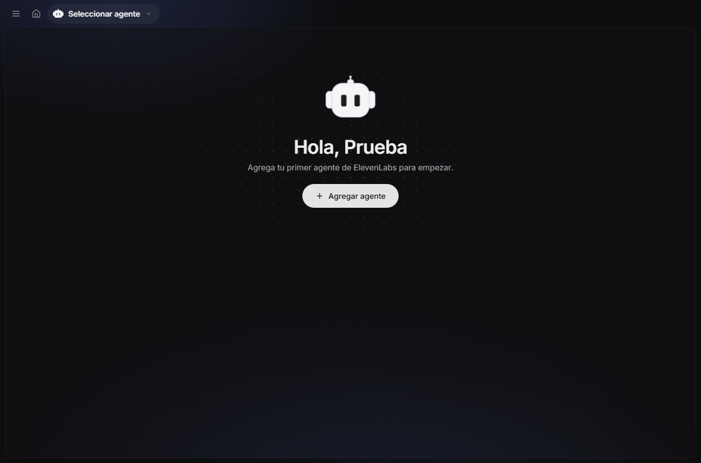
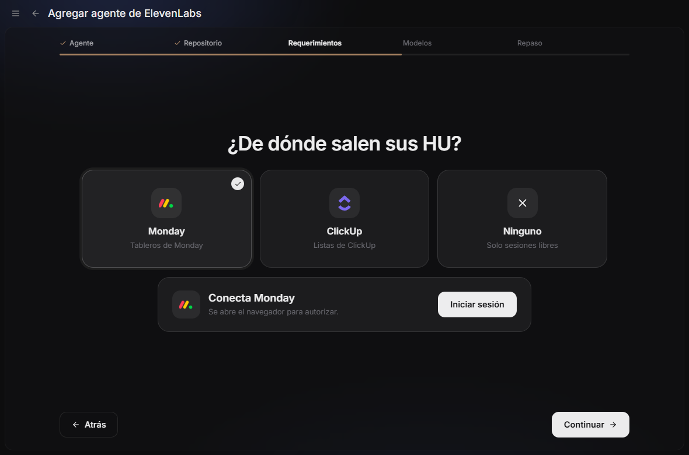
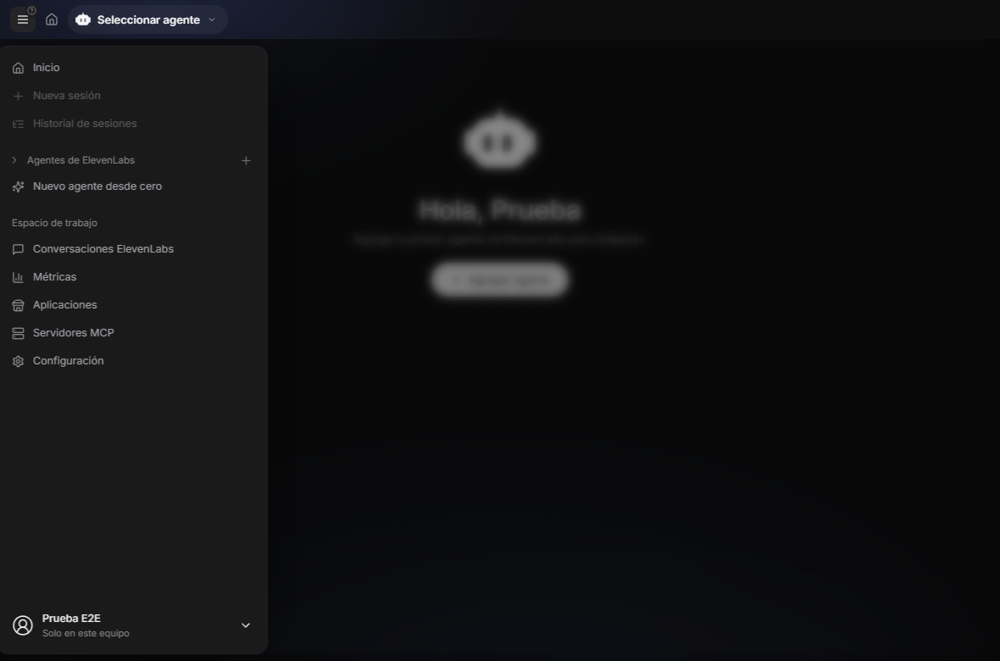
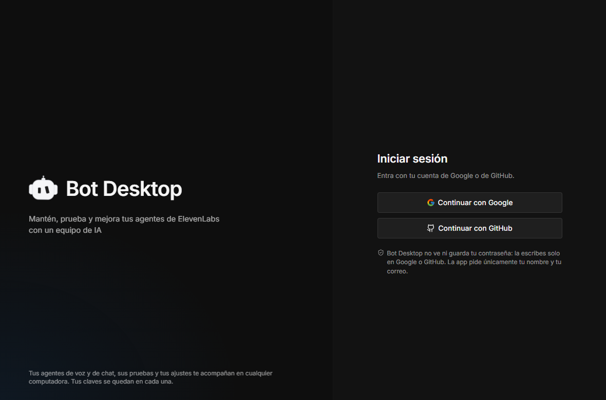
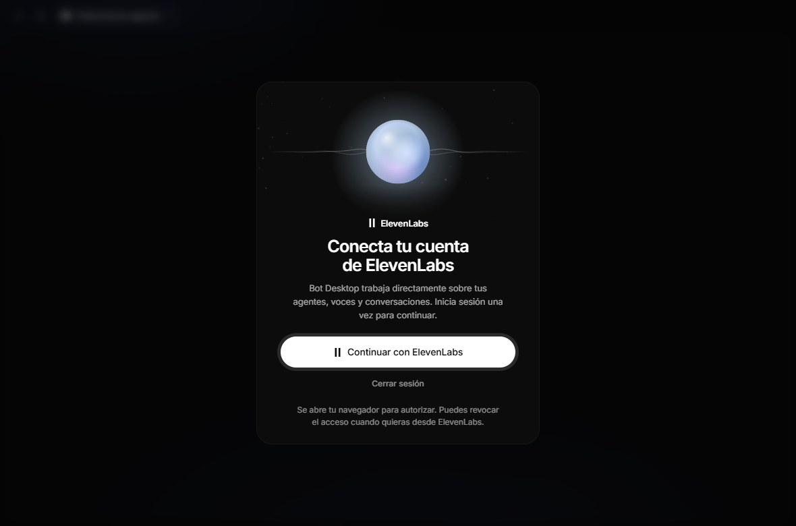

# Bot Desktop

**Mantén, prueba y mejora tus agentes de ElevenLabs con un equipo de IA.**

[Descargar](#instalar) · [Qué hace](#qué-puedes-hacer) · [Consejos](#consejos) · [Problemas frecuentes](#problemas-frecuentes)

Bot Desktop es una aplicación de escritorio para Windows que trabaja sobre tus agentes de voz y de chat de
ElevenLabs. Registras un agente y abres una sesión sobre él. El asistente revisa su prompt, sus herramientas y su base
de conocimiento, propone y aplica los cambios en una rama de pruebas y los prueba por chat, por voz o por el widget.
Nada llega a tu agente hasta que tú lo apruebas.

> [!NOTE]
> Este repositorio solo contiene los instaladores. Los archivos «Source code» que GitHub añade a cada versión
> solo traen este README.

## Qué puedes hacer

- **Trabajar sobre tus agentes de ElevenLabs.** Los registras desde tu cuenta, o creas uno nuevo desde cero, y cada
  uno tiene sus sesiones, su historial y sus métricas.
- **Hablar con un asistente que hace el trabajo.** Pídele lo que necesites en lenguaje natural. Tiene tres modos:
  - **Agente:** hace lo que le pides, paso a paso.
  - **HU's:** lleva una historia de usuario de principio a fin.
  - **Plan:** primero propone qué hará y espera tu visto bueno.
- **Llevar historias de usuario de principio a fin.** Las tomas de Monday o ClickUp, y el asistente las entiende,
  planifica, construye, prueba y compara. Se detiene para que apruebes antes de publicar.
- **Probar como lo haría un cliente.** Usa chats de prueba simulados, llamadas de prueba por voz (con revisión de
  pronunciación) y pruebas desde el widget del agente.
- **Conectar tus herramientas iniciando sesión, sin pegar tokens.** GitHub, Monday, ClickUp, Notion, Linear, Google
  Drive, Gmail, Outlook, OneDrive y cualquier servidor MCP.
- **Elegir los modelos de IA.** Puedes usar tu suscripción de Claude (vía Claude Code), DeepSeek, Grok, OpenCode Go,
  Anthropic u OpenAI. Si un modelo falla, se pasa al siguiente de la lista.
- **Seguir trabajando desde cualquier computadora.** Tus agentes, sesiones y chats aparecen en cada equipo donde
  inicies sesión.

<table>
  <tr>
    <td width="50%"></td>
    <td width="50%"></td>
  </tr>
  <tr>
    <td align="center">Agregar un agente, paso a paso</td>
    <td align="center">Todo el espacio de trabajo desde el menú ☰</td>
  </tr>
</table>

## Requisitos

- Windows 10 (versión 1809 o posterior) u 11, de 64 bits, con unos 1,1 GB libres.
- Una cuenta de **Google** o de **GitHub** para iniciar sesión.
- Una cuenta de **ElevenLabs** con tus agentes.
- Al menos un proveedor de IA: tu suscripción de Claude o la clave de alguno de los otros.

## Instalar

1. Descarga `BotDesktop-Setup-<versión>.exe` de la
   [última versión](https://github.com/kjohan159319/bot-desktop-releases/releases/latest).
2. Ábrelo y elige **Instalar**. Por defecto se instala para todos los usuarios y pide permiso de administrador una
   sola vez. Con **Personalizar la instalación** puedes instalarlo **solo para ti**, sin permisos de administrador.
3. Si quieres, el instalador deja listos Git, GitHub CLI, la máquina virtual de los agentes (WSL2) y el inicio con
   Windows.

> [!IMPORTANT]
> Windows puede mostrar **«Windows protegió tu PC»** la primera vez. Elige **Más información › Ejecutar de todas
> formas**. Solo pasa al instalar: las actualizaciones llegan sin ese aviso.

## Primeros pasos

<table>
  <tr>
    <td width="50%"></td>
    <td width="50%"></td>
  </tr>
</table>

1. **Inicia sesión** con Google o GitHub. Bot Desktop no ve ni guarda tu contraseña.
2. **Conecta tu cuenta de ElevenLabs.** Se abre el navegador para autorizar, y puedes revocar el acceso cuando quieras
   desde ElevenLabs.
3. **Configura un proveedor de IA** en Configuración › Proveedores de IA.
4. **Agrega tu primer agente** desde el inicio y abre una sesión.

## Actualizaciones

No tienes que hacer nada. Bot Desktop busca versiones nuevas al abrirse y cada 6 horas, las descarga en segundo plano
y te avisa. La actualización se aplica cuando eliges **Reiniciar y actualizar**, y nunca mientras hay una historia de
usuario o un agente trabajando.

> [!TIP]
> Para buscar ahora mismo, ve a **Configuración › Acerca de › Buscar ahora**.

Antes de instalar, cada actualización se comprueba: tiene que venir firmada y coincidir con lo publicado. Si algo
falla a mitad, la app vuelve a la versión que tenías.

## Consejos

- **Atajos:**

  | Atajo | Qué hace |
  |---|---|
  | `Ctrl+Ñ` | Terminal |
  | `Mayús+Tab` | Cambiar de modo en el compositor |
  | `Esc` | Cerrar paneles |
  | `Enter` | Enviar |
  | `Mayús+Enter` | Nueva línea |
- **Revisa antes de aprobar.** Las acciones que cambian algo piden tu aprobación; las de solo lectura se ejecutan
  solas.
- **Usa el modo Plan para cambios grandes:** primero ves qué va a hacer el asistente.
- **Más fluidez con Windows Defender.** En Configuración › Acerca de › Rendimiento hay un comando opcional para excluir
  los datos de la app del análisis. La app nunca cambia Defender por su cuenta.
- **La máquina virtual se apaga sola** tras 5 minutos sin uso, para no consumir memoria. Puedes ajustarlo en
  Configuración › Máquinas.
- **Si algo falla**, en Configuración › Acerca de puedes exportar un diagnóstico (un .zip con los registros de los
  últimos 7 días) para compartirlo.

## Privacidad y seguridad

- Tus **claves de API y los inicios de sesión de tus apps** se guardan cifrados en tu equipo.
- **Cada actualización** se verifica antes de instalarse.
- Los **informes de fallos** no llevan claves ni el contenido de tus chats, y se desactivan en Configuración › Acerca
  de.

## Desinstalar

Desde **Configuración de Windows › Aplicaciones › Bot Desktop › Desinstalar**. Puedes elegir si se borran también tus
datos locales.

## Problemas frecuentes

<b>No me aparece la actualización</b>

La app espera unos segundos después de abrirse antes de buscar. Ve a Configuración › Acerca de › **Buscar ahora**.
Cuando la descarga termina, aparece **Reiniciar y actualizar**.

<b>Windows bloquea el instalador</b>

Elige **Más información › Ejecutar de todas formas**. Solo pasa en la primera instalación.

<b>La actualización no se aplica</b>

Se espera a que terminen las historias de usuario y los agentes que estén trabajando. Si sigue sin aplicarse, exporta
el diagnóstico desde Configuración › Acerca de y compártelo.

